<p align="center"></p>

<h3 align="center">A dual-gateway firewall for language-model applications</h3>

<p align="center">
Screens every prompt before a model reads it and every answer before a person does,<br>
and streams each layer's decision to the browser as it happens.
</p>

<p align="center">
<a href="https://heimdall-a-dual-gateway-firewall-fo.vercel.app">Live console</a> ·
<a href="https://ragas111-heimdall-middleware.hf.space/health">Middleware health</a> ·
<a href="#results">Results</a> ·
<a href="#research">Research</a> ·
<a href="#run-it">Run it</a>
</p>

<p align="center">


</p>

> **What it is, and is not.** A research prototype with an audited evaluation record. It reduces exposure to prompt injection and makes every decision inspectable. It does not solve prompt injection, and every figure below states the conditions it was measured under.

---

## Contents

- [At a glance](#at-a-glance)
- [Architecture](#architecture)
- [How a request is screened](#how-a-request-is-screened)
- [The layers](#the-layers)
- [Human review](#human-review)
- [Results](#results)
- [Research](#research)
- [Security coverage](#security-coverage)
- [Known limits](#known-limits)
- [Run it](#run-it)
- [Test it](#test-it)
- [Repository](#repository)

---

## At a glance

| | |
|---|---|
| **Third-party attacks stopped** | **723 of 808** (89.5%) on a sealed benchmark half never read during tuning |
| **Benign prompts wrongly stopped** | **2 of 1,007** (0.2%) on the same sealed half |
| **Live runs on real providers** | 50 of 50 attacks stopped, 0 of 50 benign blocked, in each of two runs |
| **Detection layers** | 6 input layers (L0 to L5), 5 output layers (O1 to O5), prompt hardening in between |
| **Rules** | 285 L1 rules, scanned across up to 14 de-obfuscated views of each prompt |
| **Throughput** | 116 to 166 deterministic scans a second per worker |
| **Tests** | 499 middleware (510 with Redis), 129 backend, 21 browser end-to-end, all passing |
| **Deployments** | Docker Compose (one command), or Hugging Face Spaces + Vercel + Upstash Redis |

---

## Architecture

Three services. The console is static; the middleware holds both gateways; the backend fans a prompt out to three model providers.

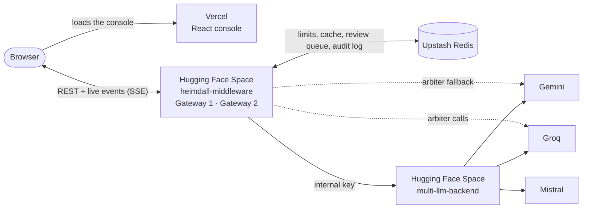

The same three services run locally with one `docker compose up`, with Redis in a fourth container and nginx serving the console.

---

## How a request is screened

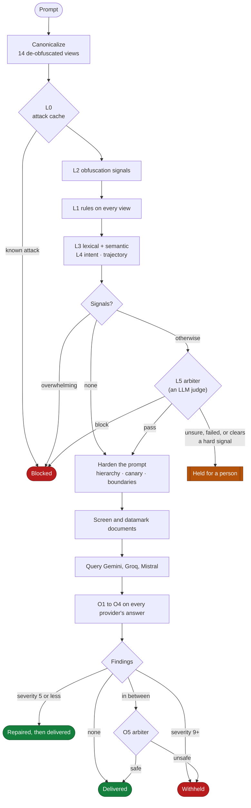

What the browser sees while this runs:

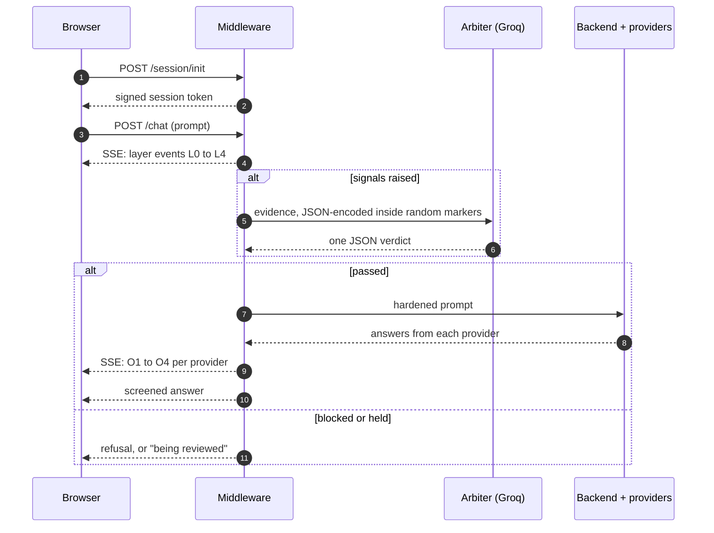

Text is released only after screening. Events before that carry status, never answer text.

---

## The layers

**Gateway 1, on the prompt**

| Layer | What it does |
|---|---|
| Canonicalizer | Builds up to 14 views that undo Unicode tag smuggling, look-alike letters, leetspeak, spaced or split words, rot13, reversal, escapes, and Base64, Base32, hex, binary and Morse to depth 2 |
| L0 cache | Exact and near-duplicate matches against attacks already confirmed |
| L2 signals | Flags each obfuscation technique it had to undo |
| L1 rules | 285 rules over every view, under a 50 ms regex budget; benign look-alikes guarded by `unless` conditions |
| L3 lexical | Hashed character n-gram model (`lex-2`, out-of-fold AUC 0.995); a strong signal on its own at 0.95 or above |
| L3 semantic | Embedding similarity to a bank of full-sentence attacks (bge-small, ONNX, no GPU) |
| L4 intent | Authority, urgency and evasion scoring; a trajectory monitor watches multi-turn drift |
| L5 arbiter | An LLM judge (Groq, Gemini fallback) at temperature 0. It reads attacker text, so it is untrusted too: it cannot clear corroborated critical evidence, and when it clears a hard signal a person decides |

**Between the gateways:** every system message states an instruction hierarchy and carries a per-session canary; flagged text is wrapped in random boundaries; every document is datamarked and screened on its own.

**Gateway 2, on each provider's answer**

| Layer | What it does |
|---|---|
| O1 | Cache of answers already judged unsafe |
| O2 | Canaries across decoded views, overlap with the system prompt, 11 secret formats, card numbers, jailbreak confirmations |
| O3 | Persona shift and compliance with an override |
| O4 | Auto-loading images, scriptable markup, encoded exfiltration URLs, email worms, shell pipes |
| O5 | The arbiter, for findings that are neither clearly fine nor clearly unsafe |

---

## Human review

When the machine cannot decide safely, a person does. Callers that ignore the hold still fail closed, because a held request's verdict stays `BLOCK`.

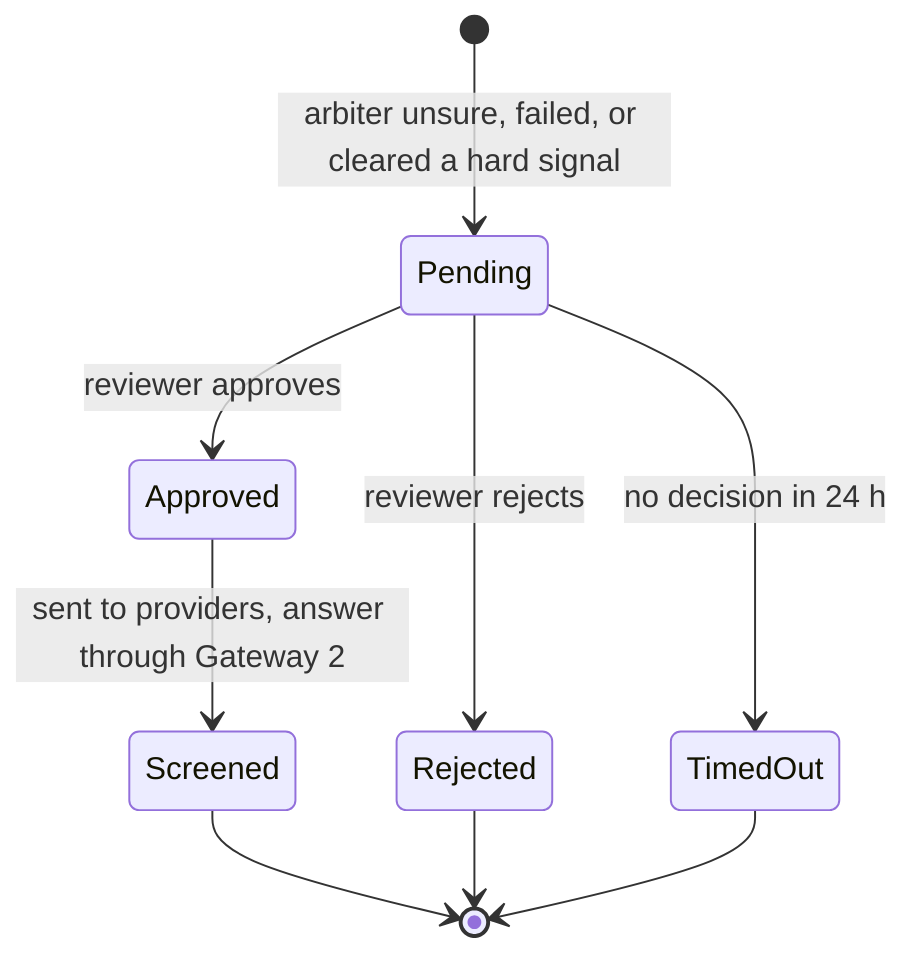

With Redis, the queue is shared by every instance and survives restarts; the first reviewer to decide wins. Every decision lands in a tamper-evident audit chain (HMAC per entry, each linked to the last) and an append-only label log.

---

## Results

Every figure is interception at the gateway unless it says otherwise, with Wilson 95% intervals. Sources: `knowledge-base/05-evaluation/`.

### Third-party attacks, sealed half

Tensor Trust and garak attacks plus Alpaca benign prompts, split into development and test halves by a hash of each prompt's text, so the split could not be chosen. Rules and the lexical model were tuned on the development half only. The test half was opened only by the scorer, once, after the detection files were hashed. Arbiter off, no embedding model.

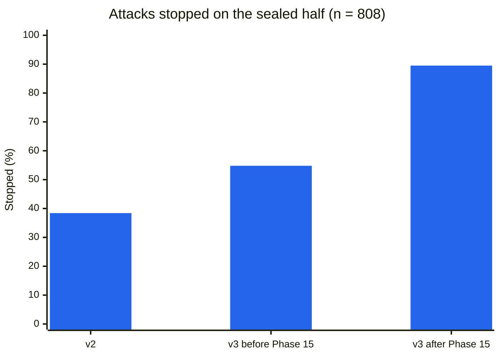

| | n | v2 | v3 before | **v3 after** | 95% interval |
|---|---|---|---|---|---|
| Attacks stopped | 808 | 310 | 443 | **723** | 87.2 to 91.4% |
| Benign wrongly stopped | 1,007 | 0 | 2 | **2** | 0.1 to 0.7% |

By source, after Phase 15:

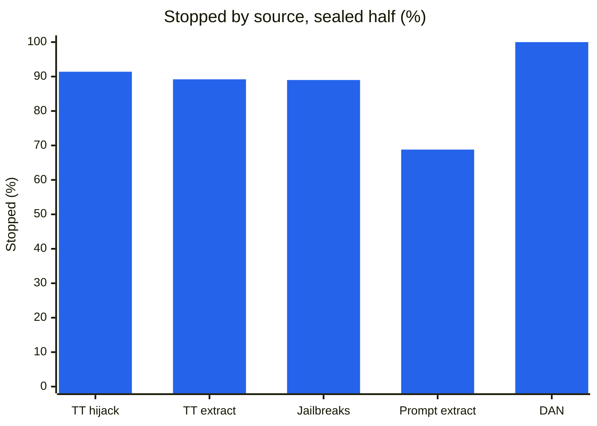

| Source | Stopped |
|---|---|
| Tensor Trust hijacking | 233 of 255 |
| Tensor Trust extraction | 189 of 212 |
| In-the-wild jailbreaks (garak) | 284 of 319 |
| System-prompt extraction (garak) | 11 of 16 |
| DAN (garak) | 6 of 6 |

### Held-out adaptive attacks (Phase 12)

60 automated mutations built to evade earlier rules, plus 100 benign prompts. Their text was never read during tuning, but the set has now been scored three times, so it is weaker evidence than the sealed half above. The first, frozen scoring is the cleanest estimate.

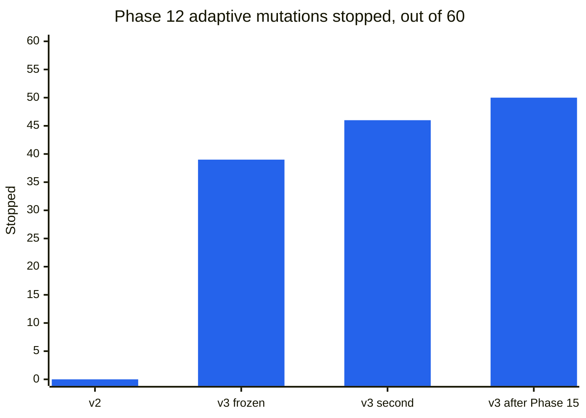

Benign prompts wrongly stopped: 0 of 100 at every scoring.

### Development sets, v2 against v3

The rules were written against these, so they show coverage of known techniques, not generalisation.

| Set | n | v2 | v3 | Exact McNemar p |
|---|---|---|---|---|
| Development attacks | 328 | 109 | **315** | 1.9e-62 |
| Development benign, wrongly stopped | 128 | 18 | **0** | 7.6e-6 |

### Gateway 2

An authored check of 32 unsafe and 40 clean answers. It shows the output layers work as built, nothing more.

| | Before | After |
|---|---|---|
| Unsafe answers handled | 26 of 32 | **32 of 32** |
| Clean answers altered | 2 of 40 | 2 of 40 |

### Live runs on real providers

The full stack, real Gemini, Groq and Mistral keys on free tiers, 50 or more development prompts of each kind. Runs D and E used the Docker Compose stack in production mode with Redis and the embedding model active.

| Run | Date | Attacks stopped | Benign blocked | Arbiter calls | Note |
|---|---|---|---|---|---|
| A | 12 Nov | 17 of 20 | 0 of 20 | 15 | Gemini and Groq |
| B | 12 Nov | 98 of 100 | 0 of 51 | 61 | 49 benign got no answer: every provider rate-limited |
| C | 12 Nov | 49 of 50 | 0 of 50 | 35 | 6 arbiter replies unreadable, then fixed |
| D | 13 Nov | **50 of 50** | **0 of 50** | 37 | Compose stack; 0 unreadable replies |
| E | 13 Nov | **50 of 50** | **0 of 50** | 36 | With per-layer diagnostics |

Where run E stopped its attacks, and which layers raised the signals:

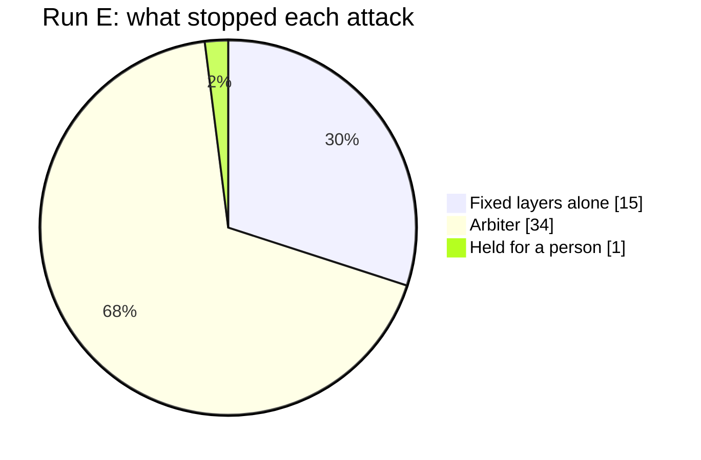

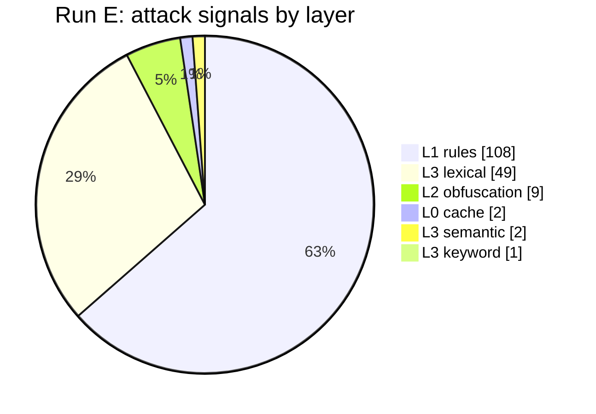

What the live runs changed: the arbiter's output budget (unreadable replies), its temperature (verdicts that differed between runs), the rule that it may not clear a hard signal on its own, and a new rule family for text addressed to the reading model. Attack success on the model has not been measured yet: in runs D and E nothing got through to judge.

### Speed

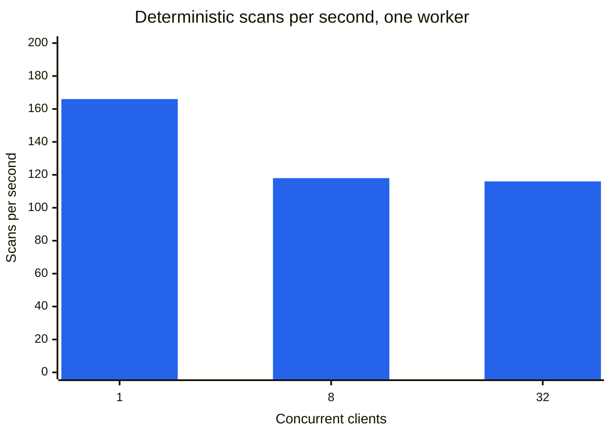

95th-percentile latency 7.6 ms at concurrency 1, 141 ms at 8, 372 ms at 32. A worker is CPU-bound, so capacity comes from more workers, which the shared Redis limiter makes safe. On the live stack, an arbiter call took 0.2 to 0.8 s and a benign chat about 1 s end to end.

---

## Research

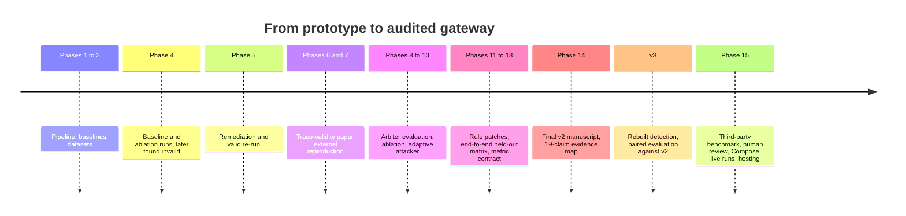

**What the v2 study found** (`knowledge-base/07-paper-kit/manuscript.md`), on a local model with a planted secret:

- 35 of 72 attacks extracted the secret end to end before patching, 32 of 72 after. Patches closed the known seeds (3 of 12 exposed, then 0) but not adaptive mutations (58 of 60 still reached the model).
- L1 rules carried the defence: removing them alone raised bypass from 3 of 52 to 50 of 52.
- With the arbiter down, sending more benign traffic to it raised false blocks from 0% to 100% without any security gain.

**What changed in v3 because of it:** canonicalization before every layer, signals instead of verdicts from each layer, an arbiter treated as untrusted, human review instead of blind fail-closed, and evaluation on attacks the project did not write.

**Method.** Each result separates a layer's *signal* from the gateway's *verdict*, gateway *interception* from the model actually *doing* what the attacker wanted, and an arbiter outage from an arbiter decision. Held-out data is opened only by scorers that print counts. Claims and their evidence are listed in `knowledge-base/05-evaluation/claims-ledger.yaml`.

---

## Security coverage

Mapped to the OWASP Top 10 for LLM Applications 2025:

| Risk | Coverage |
|---|---|
| LLM01 Prompt Injection | **Partial, the focus**: Gateway 1, prompt hardening, document screening |
| LLM02 Sensitive Information Disclosure | Partial: O2 secrets and PII, redaction |
| LLM05 Improper Output Handling | Partial: O4 stripping, text-only rendering |
| LLM07 System Prompt Leakage | Partial: canaries, overlap detection, extraction rules |
| LLM10 Unbounded Consumption | Partial: rate limits, size limits, circuit breakers, arbiter only when flagged |
| LLM03, 04, 06, 08 | Minimal to limited |
| LLM09 Misinformation | Not addressed |

Also: HMAC session tokens issued by the server, an internal key between services, a tamper-evident admin audit log, strict content security policy, and no prompt or answer text in logs.

---

## Known limits

1. **Attack success on a live model is not yet measured** for v3. The live runs measure interception; nothing got through to judge.
2. **85 of 808 sealed attacks still pass** the fixed layers, and rules decay as attackers adapt.
3. **One benchmark family.** The sealed half shares its sources with the development half; it measures generalisation within Tensor Trust, garak and Alpaca.
4. **The arbiter is lightly measured** and not fully repeatable, even at temperature 0.
5. **Gateway 2 alters code answers by default**: markup such as `` or `<form>` is stripped even inside code blocks, unless `G2_CODE_BLOCKS=keep`.
6. **No tool-call validation.** O4 reads text only.

Full list: `knowledge-base/05-evaluation/limitations.md`.

---

## Run it

**Docker, one command** (console, middleware, backend, Redis):

```bash
cp .env.example .env        # four secrets and at least one provider key
docker compose up -d --build
```

Open http://localhost:8080. Only that port is published, and only on this machine unless you change `HEIMDALL_BIND`.

**Hosted:** Hugging Face Spaces for the backend and middleware, Vercel for the console, Upstash for Redis. Step by step, with a settings template for each service and a push script: [`deploy/README.md`](deploy/README.md).

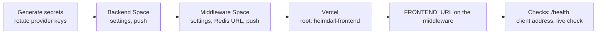

**Without Docker**, for development:

```bash
cp heimdall-middleware/.env.example heimdall-middleware/.env
cp multi-llm-backend/.env.example multi-llm-backend/.env
# Set ADMIN_KEY and SESSION_SIGNING_KEY, the same INTERNAL_AUTH_KEY in both files, and provider keys.
./start_heimdall.sh        # Windows: start_heimdall.bat
```

Open http://localhost:5173. With no provider keys, run `uvicorn mock_llm_backend:app --port 8001 --app-dir evaluation` in place of the backend.

**Settings worth knowing**

| Setting | Default | Effect |
|---|---|---|
| `HEIMDALL_ENV` | `production` in the images | Production refuses to start without strong secrets |
| `USE_FAKE_REDIS` | `true` | `false` puts limits, cache, review queue and audit log in Redis (`REDIS_URL`) |
| `REVIEW_ON_ARBITER_FAILURE` | `review` | `legacy` blocks hard signals and forwards soft ones instead of asking a person |
| `ARBITER_CONFLICT_ACTION` | `review` | What happens when the arbiter clears a hard signal: `review`, `block` or `allow` |
| `G2_CODE_BLOCKS` | `strip` | `keep` leaves markup inside code blocks, for clients that never render raw HTML |
| `TRUSTED_PROXY_HOPS` | `0` | Proxies in front, so rate limits see the real client address |

---

## Test it

```bash
cd heimdall-middleware && HEIMDALL_ENV=test EMBEDDINGS_ENABLED=false RATE_LIMIT_CHAT=100000 RATE_LIMIT_SCAN=100000 RATE_LIMIT_SESSION=100000 RATE_LIMIT_ADMIN=100000 RATE_LIMIT_DEFAULT=100000 pytest tests -q
# add HEIMDALL_TEST_REDIS_URL=redis://localhost:6379/15 to run the Redis tests too (flushes that database)
cd multi-llm-backend && pytest -q
cd heimdall-frontend && npx playwright test
python evaluation/run_gateway_eval.py --suites dev
python evaluation/live_provider_check.py --stack --url http://localhost:8080/api --n 50 --delay 6   # real providers
```

The live check sends development attacks and benign prompts through a running stack and saves a result file under `evaluation/results/`. With `ADMIN_KEY` set, each case records which layer raised each signal and what Gateway 2 removed, never prompt or answer text. Attacks that get through are judged for whether they worked.

---

## Repository

| Path | Contents |
|---|---|
| [`heimdall-frontend`](heimdall-frontend) | React console: chat with live layer view, attack lab, analytics, research, review queue, policy, immune system |
| [`heimdall-middleware`](heimdall-middleware) | Both gateways, sessions, human review, immune system, research API |
| [`multi-llm-backend`](multi-llm-backend) | Gemini, Groq and Mistral fan-out |
| [`evaluation`](evaluation) | Paired evaluator, corpora, external benchmark builder, lexical trainer, live check, attack judge |
| [`deploy`](deploy) | Hugging Face and Vercel guide, settings templates, push scripts |
| [`research`](research) | Phases 8 to 14, final manuscript, evidence |
| [`assets/logo`](assets/logo) | Logo pack |

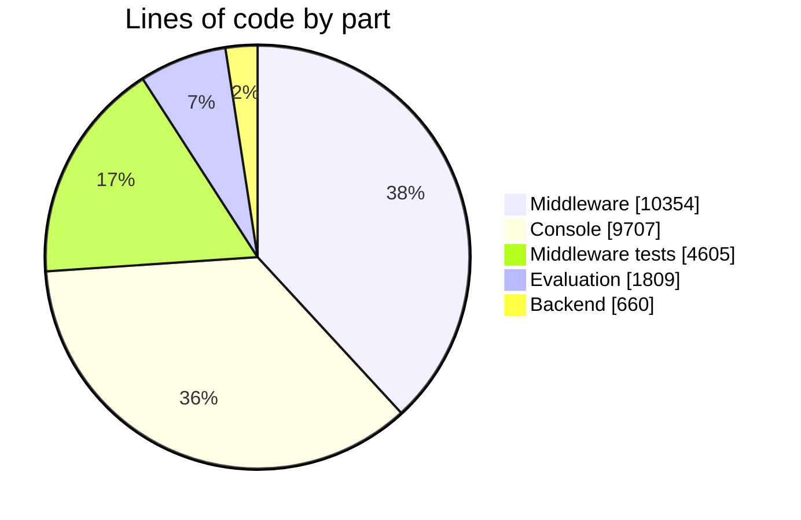

The knowledge base (architecture, security audit, operations, paper kit, research archive) ships separately; start with its `README.md`.

---

## Credits

Created by Pushkar Khattri. Hero field adapted from Origin Kit. Text reveal adapted from React Bits (MIT + Commons Clause). Line figures by Hairline. Design rules from Hallmark.

The shipped lexical model was trained partly on Stanford Alpaca (CC BY-NC 4.0) and Tensor Trust data; check those terms before commercial use, or retrain with `python evaluation/train_lexical.py --no-external`.

This repository has no licence file, so default copyright applies until one is added.
